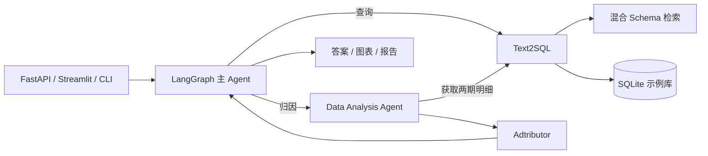

# InsightFlow

InsightFlow 面向中文经营分析。它将自然语言问题转成可执行的数据库查询，也能拆解指标变动，说明哪些渠道、品类或客户分组贡献最大。用户可通过命令行、FastAPI 或 Streamlit 获取中文答案、图表和报告。

## 从提问到答案



| 环节 | 实现 |
|---|---|
| 主 Agent | LangGraph 管理会话状态、工具分派和结果汇总。主模型先识别贡献归因意图，普通查询走 Text2SQL，变动归因委派给 Data Analysis Agent。 |
| Schema 检索 | BM25 检索字段名称和描述，Embedding 在 Chroma 中召回语义相近的字段。RRF 合并排序后，通过专用 Reranker 接口重排候选，再为 SQL 生成选择相关表和字段。 |
| Text2SQL | 根据业务口径和 Schema 生成 SQL，经只读校验后在数据库上执行。工作流识别执行错误，按配置限制重试次数和结果行数。 |
| 子 Agent 协作 | 归因子 Agent 先自行查询两期分组明细，再调用 Adtributor。针对可核对的绝对指标，用 Decimal 计算合计、差额和净变化贡献率，按用户约定的结构生成结果。 |
| HITL 与权限边界 | AskHuman 在信息不足时挂起工作流，收到补充后恢复。可选的 SQL 置信度门控支持人工批准、拒绝或修改。会话状态按用户和线程传递，归因流程限制可调用工具，Python 分析在 Docker 中隔离执行。面向外网部署时需在接口前配置身份认证，并为业务库配置只读账号。 |

主要实现位于 `insightflow/agent_graph.py`、`insightflow/analysis/`、`insightflow/catalog/` 和 `insightflow/text2sql/`。中文 Prompt 在 `insightflow/prompts/`，示例业务规则在 `example/enterprise/bi.yaml`。

## 真实端到端评测

50 道任务从主 Agent 入口运行，覆盖查询、归因、澄清、多步骤分析、图表和报告留存。四个隔离进程并行执行不同题目。

| 指标 | 实测结果 |
|---|---:|
| 端到端任务成功率 | **88.00%**（44/50） |
| 最终答案正确率 | **92.00%**（46/50） |
| 主 Agent 路由准确率 | **96.00%**（48/50） |
| 工具调用成功率 | **96.77%**（120/124） |
| 平均 / P95 端到端延迟 | **59.84 / 134.08 秒** |

答案正确率按要求的业务字段及类型评分。任务成功还要求路由、工具和交付物满足题意。6 道归因题均完成父子调用链，5 道满足全部交付要求。一次失败来自返回渠道编号，而题目要求中文渠道名。结果适用于当前示例库和冻结题库。[正式报告](evals/reports/agent_release_50/FINAL_REPORT.md) · [评分规则](evals/reports/agent_release_50/SCORING.md) · [逐题摘要](evals/reports/agent_release_50/CASE_SUMMARY.json)

## 安装与配置

以下 PowerShell 命令从仓库根目录执行，需要 Python 3.11 和 uv。Linux、macOS 可使用同一组 `uv` 命令，并用 `cp` 复制模板。

```powershell
uv sync --locked --python 3.11 --no-dev --extra test
if (!(Test-Path .env)) { Copy-Item .env.example .env }
if (!(Test-Path insightflow/config.yaml)) { Copy-Item insightflow/config.yaml.template insightflow/config.yaml }
```

在本机 `.env` 中填写 `DASHSCOPE_API_KEY`。Chat、Embedding 和 Reranker 分别读取 `DASHSCOPE_CHAT_MODEL`、`DASHSCOPE_EMBEDDING_MODEL` 和 `DASHSCOPE_RERANK_MODEL`。模板对应正式评测使用的 Qwen 模型与 1024 维向量。使用其他百炼地域或工作空间时，同时调整 Chat/Embedding 基础 URL 和 Reranker 完整端点。

模板指向随仓库分发的中文模拟 SQLite 库，包含六张表和 5,000 张订单。Schema、业务说明和固定种子生成器在 `example/enterprise/`。公开版首次启动任一运行入口时，会按配置调用 Embedding 服务，并将索引写入本机 `.chroma_qwen37`。索引目录缺失时也按相同流程构建，已有的兼容索引可直接复用。请在构建完成后再启动其他入口。

## 运行

从仓库根目录启动所需入口。

```powershell
# 命令行
uv run --no-sync python run_cli.py "2025年有多少张已完成订单？"

# Streamlit，浏览器打开 http://localhost:8501
uv run --no-sync python run_streamlit_ui.py

# FastAPI，接口文档 http://127.0.0.1:8000/docs
uv run --no-sync uvicorn sample_api.async_api:app --host 127.0.0.1 --port 8000
```

在 FastAPI 文档中向 `POST /chat/stream` 提交下方请求。后端以 NDJSON 流返回执行事件和最终回答。也可以在页面提问“以 2025 年 10 月为基期，分析 11 月各渠道对处理中商品件数变化的贡献”。

```json
{"input":"统计各商品品类的商品数量，用柱状图展示。","user_id":"demo","session_id":"catalog-demo","mode":"events"}
```

使用 Python 分析工具时，需启动 Docker 并准备执行器镜像。时间序列预测服务为可选组件，有独立的部署步骤。[预测服务说明](timeseries_forecasting/README.md)

## 离线验证

```powershell
uv run --no-sync python evals/verify_public_metrics.py
uv run --no-sync python -m pytest -o addopts= -q tests/analysis/test_verified_answer.py tests/eval/test_enterprise_demo_data.py
```

第一条命令从公开的逐题结果复算五项指标，并核对冻结题号。第二条验证已有归因证据、JSON 输出及演示数据库生成规则。正式评测使用的模型响应、调用日志及本机状态均未随公开材料分发。

